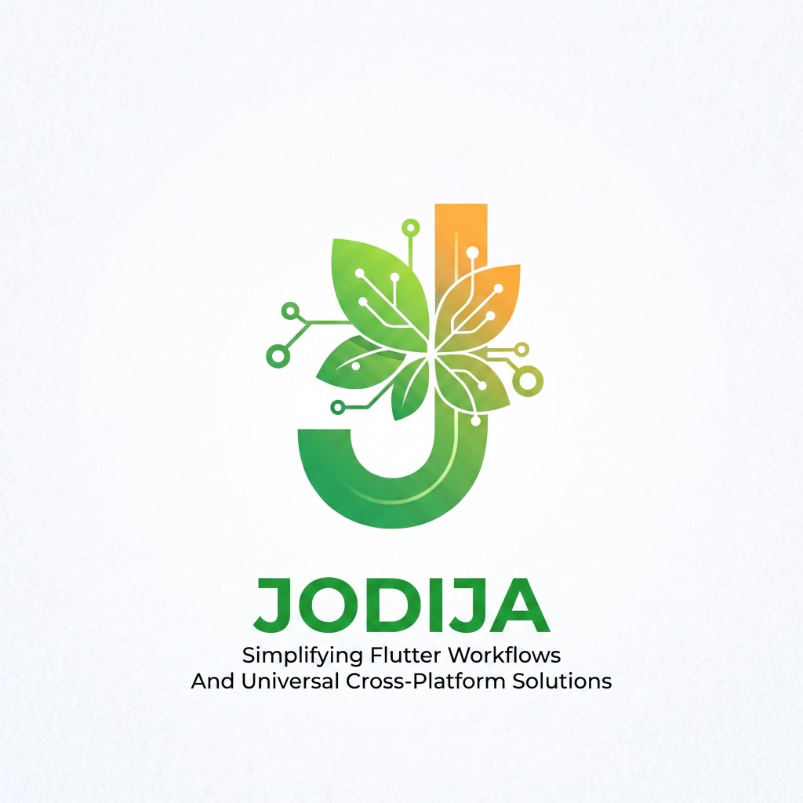

# JoDija Repository (`jodija_repository`)

[](https://pub.dev/packages/jodija_repository)
[](https://github.com/zeftawyapps/JoDija_reposatory/blob/master/LICENSE)
[](https://pub.dev/packages/jodija_repository)

A unified **Data Repository, REST Networking (Dio), and Firebase Integration** framework for Flutter applications across **Android, iOS, Web, macOS, Windows, and Linux**.

🌐 **Read in Arabic / اقرأ باللغة العربية:** [🇸🇦 الدليل الكامل بالعربية (README.ar.md)](https://github.com/zeftawyapps/JoDija_reposatory/blob/master/README.ar.md) • [📚 Documentation Portal](https://github.com/zeftawyapps/JoDija_reposatory/blob/master/documents/README.md)

---

## Why `jodija_repository`?

In real-world Flutter projects—whether you are building a **single standalone app** or a **multi-app platform** (Customer App, Merchant App, Admin Dashboard sharing one business-logic package)—you shouldn't have to rewrite Dio interceptors, JWT headers, localization headers, error mapping, and Firestore CRUD boilerplate in every project.

`jodija_repository` gives you one consistent data-layer contract:

```text
+-------------------------------------------------------------------+
|               Flutter UI / BLoC / Cubit / Use Cases               |
+---------------------------------+---------------------------------+
                                  |
                                  v
+-------------------------------------------------------------------+
|                       Unified Repositories                        |
|   DataSourceRepo<T>  |  LoadDataRepo<T>  |  StreamRepo  | AuthRepo|
|            Returns type-safe Result<RemoteBaseModel, T>           |
+-----------------+-------------------------------+-----------------+
                  |                               |
                  v                               v
+---------------------------------+ +-------------------------------+
|      REST API Data Sources      | |     Firebase Data Sources     |
| - DataSourceDataActionsHttp...  | | - DataSourceFirebaseSource<T> |
| - LoadDataHttpSources<T>        | | - StreamFirebaseDataSource<T> |
| - Dio HttpClient + Multipart    | | - StorageActions (Uploads)    |
| - Auto Bearer JWT & x-lang      | | - Email & Google Sign-In      |
+---------------------------------+ +-------------------------------+
```

### Key Features

* **Multi-Environment Routing (`DataSourceConfigration`):** Switch seamlessly between `local`, `remote_dev`, and `remote_prod` API & CDN URLs via JSON config or Dart code.
* **Dio HTTP Client (`HttpClient`):** Built-in `GET`, `POST`, `PUT`, `PATCH`, `DELETE`, multipart file uploads, `CancelToken` support, automatic `Authorization: Bearer <token>`, and dynamic `x-lang` headers.
* **Type-Safe `Result` & `BaseError` Hierarchy:** Eliminates uncaught exceptions by wrapping responses in `Result<RemoteBaseModel, Data>` and mapping status codes (`400`, `401`, `403`, `404`, `409`, `500`, timeouts, socket errors) into strongly typed `BaseError` classes.
* **Ready-to-Use Firebase Connectors:** Unified CRUD (`DataSourceFirebaseSource`), real-time streams (`StreamFirebaseDataSource`), file uploads (`StorageActions`), Auth (`EmailPassowrdAuthSource`, `GoogleAuthSoucre`), and FCM (`FCMService`).
* **Structured Diagnostics (`JDRepoConsole`):** Leveled, colorized logs and execution timers that automatically stay quiet in `kReleaseMode`.

---

## Quick Start Tutorial

### 1. Installation

```bash
flutter pub add jodija_repository
```

Or in your `pubspec.yaml`:

```yaml
dependencies:
  jodija_repository: ^1.7.2
```

---

### 2. Initialize API URLs & Headers at Startup

You can configure your API URLs directly in Dart (or load them from an asset JSON file using `backendRoutedInit`):

```dart
import 'package:flutter/material.dart';
import 'package:jodija_repository/jodija_repository.dart';

class AppConfig extends DataSourceConfigration {}

Future<void> main() async {
  WidgetsFlutterBinding.ensureInitialized();

  // 1. Configure environment & base URLs
  final config = AppConfig()
    ..envType = EnvType.dev
    ..backendState = BackendState.remote_dev
    ..appType = AppType.App;

  config.setToHttpUrlsEnveiroment(
    baseUrl: 'https://api.example.com/api/v1',
    imageBaseUrl: 'https://cdn.example.com/',
  );

  // 2. Set global localization & JWT headers (injected automatically into requests)
  HttpHeader().setLangHeader(lang: 'en'); // Sends `x-lang: en`

  runApp(const MyApp());
}
```

<details>
<summary><strong>Optional: Load multi-environment URLs & Firebase config from <code>assets/config/config.json</code></strong></summary>

```json
{
  "baseUrls": {
    "local": "http://10.0.2.2:5000/api/v1",
    "remote_dev": "https://dev-api.example.com/api/v1",
    "remote_prod": "https://api.example.com/api/v1"
  },
  "imageBaseUrls": {
    "local": "http://10.0.2.2:5000/",
    "remote_dev": "https://dev-cdn.example.com/",
    "remote_prod": "https://cdn.example.com/"
  }
}
```

```dart
await config.backendRoutedInit('assets/config/config.json');
```
</details>

---

### 3. Define Your Data Model

Extend `BaseEntityDataModel` for any domain entity:

```dart
import 'package:jodija_repository/jodija_repository.dart';

class ProductModel extends BaseEntityDataModel {
  final String title;
  final double price;

  ProductModel({
    super.id,
    required this.title,
    required this.price,
  });

  factory ProductModel.fromJson(Map<String, dynamic> json, String? docId) {
    return ProductModel(
      id: docId ?? json['id']?.toString(),
      title: json['title'] as String? ?? '',
      price: (json['price'] as num?)?.toDouble() ?? 0.0,
    );
  }

  @override
  Map<String, dynamic> toJson() => {
        'id': id,
        'title': title,
        'price': price,
      };
}
```

---

### 4. Perform REST API CRUD via `DataSourceRepo`

Connect your model to any REST endpoint using `DataSourceDataActionsHttpSources` and `DataSourceRepo`:

```dart
// 1. Fetch a list of products (GET /products)
final source = DataSourceDataActionsHttpSources<ProductModel>(
  url: 'products',
  dataBuilder: (json, id) => ProductModel.fromJson(json, id),
);
final repo = DataSourceRepo<ProductModel>(inputSource: source);

final listResult = await repo.getListData();
if (listResult.hasDataOnly) {
  final List<ProductModel> products = listResult.data?.data ?? [];
  JDRepoConsole.success('Loaded ${products.length} products');
} else {
  JDRepoConsole.error('Failed: ${listResult.error?.message}');
}

// 2. Create a new product (POST /products)
final createSource = DataSourceDataActionsHttpSources<ProductModel>.inputs(
  url: 'products',
  dataModyle: ProductModel(title: 'Wireless Mouse', price: 29.99),
);
final createResult = await DataSourceRepo<ProductModel>(
  inputSource: createSource,
).addData();
```

---

### 5. Direct HTTP Requests with `HttpClient`

Need custom endpoints, query parameters, or multipart uploads directly? Use `HttpClient`:

```dart
import 'package:dio/dio.dart';
import 'package:jodija_repository/jodija_repository.dart';

final client = HttpClient(userToken: true); // Attaches Bearer token automatically

final response = await client.sendRequestResultWithMap(
  method: HttpMethod.GET,
  url: '${ApiUrls.BASE_URL}/orders/summary',
  queryParameters: {'status': 'completed'},
  cancelToken: CancelToken(),
);

if (response.hasDataOnly) {
  JDRepoConsole.info('Order summary: ${response.data}');
} else {
  JDRepoConsole.warn('Request error: ${response.error?.message}');
}
```

---

### 6. Firebase Firestore CRUD & Real-Time Streams

Because `DataSourceFirebaseSource` implements the same `IBaseDataActionsSource` contract, you can use `DataSourceRepo` with Firestore too:

```dart
// Fetch documents from Firestore collection 'products'
final firestoreSource = DataSourceFirebaseSource<ProductModel>.get(
  path: 'products',
  query: (q) => q.where('price', isGreaterThan: 10),
  builder: (json, docId) => ProductModel.fromJson(json ?? {}, docId),
);

final result = await firestoreSource.getDataList();

// Insert a document (with optional image upload to Firebase Storage)
final insertSource = DataSourceFirebaseSource<ProductModel>.insert(
  path: 'products',
  dataModel: ProductModel(title: 'Keyboard', price: 59.0),
);
await insertSource.addDataItem();
```

---

### 7. Authentication (`BaseAuthRepo`)

Unified login and registration supporting **REST APIs**, **Firebase Email/Password**, and **Google Sign-In**:

```dart
// Example A: REST API Login
final httpAuth = BaseAuthRepo(
  AuthHttpSource(email: 'user@example.com', pass: 'secret123'),
);
final loginResult = await httpAuth.logIn();

if (loginResult.hasDataOnly) {
  final user = loginResult.data!;
  HttpHeader().setAuthHeader(user.token ?? ''); // Bind JWT globally
}

// Example B: Google Sign-In (Firebase)
final googleAuth = BaseAuthRepo(GoogleAuthSoucre());
final googleResult = await googleAuth.logIn();
```

---

## Documentation & API Reference

All detailed guides and class references are available directly on GitHub:

| Guide / Reference | Description |
| :--- | :--- |
| [🇸🇦 الدليل العربي الكامل (README.ar.md)](https://github.com/zeftawyapps/JoDija_reposatory/blob/master/README.ar.md) | شرح شامل للمكتبة مع أمثلة عملية باللغة العربية |
| [🇸🇦 مقدمة الفلسفة المعمارية](https://github.com/zeftawyapps/JoDija_reposatory/blob/master/documents/ar/introduction_ar.md) | شرح معمارية الطبقات والتطبيقات أحادية ومتعددة الحلول بالعربية |
| [🇬🇧 Architecture Overview](https://github.com/zeftawyapps/JoDija_reposatory/blob/master/documents/en/introduction_en.md) | Layered architecture and multi-solution design principles |
| [⚙️ DataSourceConfiguration](https://github.com/zeftawyapps/JoDija_reposatory/blob/master/documents/en/classes/configration.md) | Environment switching (`local`, `remote_dev`, `remote_prod`) and Firebase setup |
| [🌐 HttpClient & HttpHeader](https://github.com/zeftawyapps/JoDija_reposatory/blob/master/documents/en/classes/utils/JodijaHttpClient.md) | Dio HTTP methods, multipart file uploads, JWT & `x-lang` headers |
| [🛡️ HTTP Error Hierarchy](https://github.com/zeftawyapps/JoDija_reposatory/blob/master/documents/en/classes/utils/HttpErrors.md) | All `BaseError` subclasses (`BadRequestError`, `UnauthorizedError`, etc.) |
| [📦 DataSourceRepo & Connectors](https://github.com/zeftawyapps/JoDija_reposatory/blob/master/documents/en/classes/implementations/DataSourceRepo.md) | CRUD repositories for REST APIs and Firebase Firestore |
| [🔐 BaseAuthRepo](https://github.com/zeftawyapps/JoDija_reposatory/blob/master/documents/en/classes/implementations/BaseAuthRepo.md) | HTTP, Email/Password, and Google authentication workflows |
| [🖥️ JDRepoConsole](https://github.com/zeftawyapps/JoDija_reposatory/blob/master/documents/en/classes/utils/JDRepoConsole.md) | Leveled console logging and execution performance profiling |
| [📚 Complete Class Catalog](https://github.com/zeftawyapps/JoDija_reposatory/blob/master/documents/en/classes/class_summary.md) | Full reference index of all interfaces, models, and utilities |

---

## License

This project is licensed under the MIT License — see the [LICENSE](https://github.com/zeftawyapps/JoDija_reposatory/blob/master/LICENSE) file for details.
